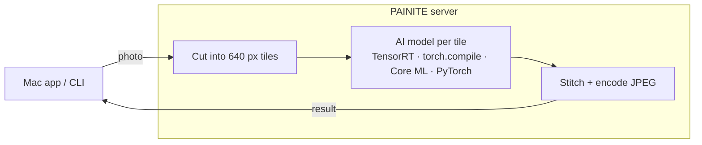
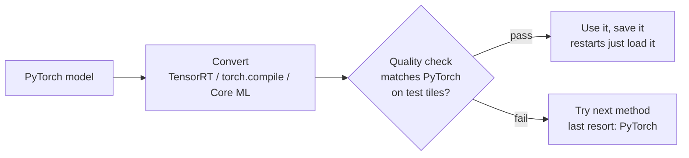
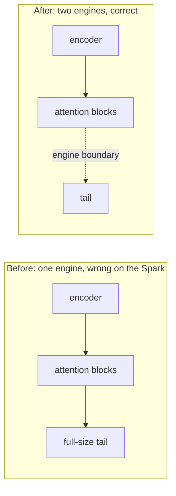
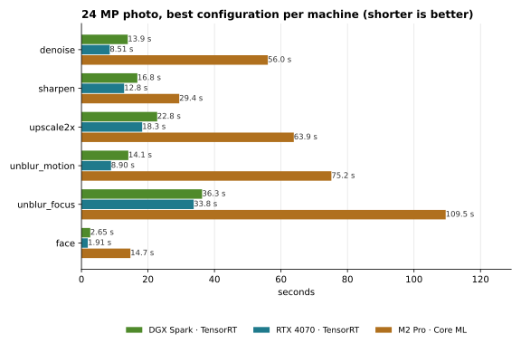
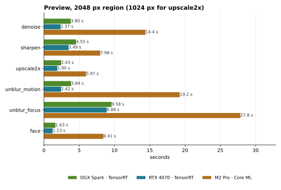
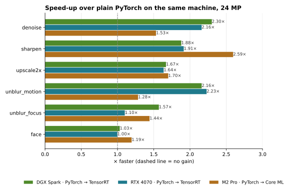
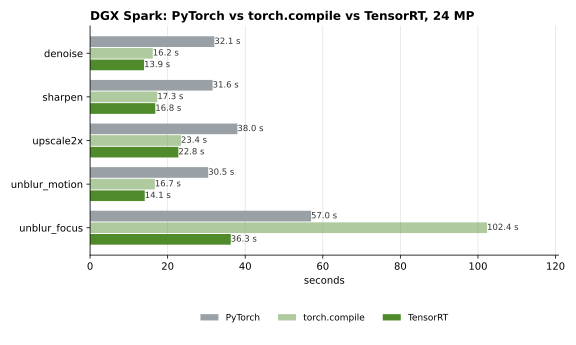
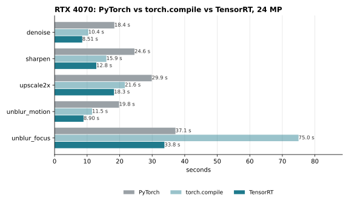
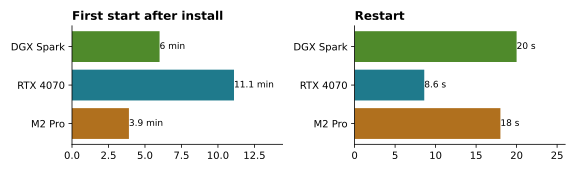

# How fast is PAINITE on a DGX Spark, a gaming PC and a Mac?

*PAINITE server performance report, measured 26–27 November 2026*

PAINITE enhances photos on a separate server: denoise, sharpen, upscale, unblur and face restoration. This report runs the same photos through the server on three very different machines, each set up the fastest way we know, and compares how long you wait.

## The short answer

* **A desktop PC with an RTX 4070 graphics card is the fastest of the three on every task.** A 24-megapixel photo takes 2 to 34 seconds depending on the task, and a preview takes 1 to 9 seconds.
* **The DGX Spark is 1.1 to 1.6 times slower than the 4070** (3 to 36 seconds per photo). What it offers instead is far more memory, 128 GB against 12 GB, which leaves room for bigger models.
* **An M2 Pro MacBook Pro works, but it is 2.3 to 8 times slower** (15 seconds to two minutes per photo). It's at its best on sharpen and upscale.
* On every machine, a speed-up layer on top of the standard AI software (TensorRT on NVIDIA, Core ML on the Mac) makes the server up to 2.6 times faster, with no visible change to the pictures.

## What we measured

Each machine ran the same six enhancement tasks on the same two real photos, through the server's normal interface, the same way the Mac app and the command-line tool use it.

| Task | What it does | Model |
|---|---|---|
| denoise | removes grain and color noise from high-ISO shots | SCUNet |
| sharpen | restores fine detail in soft photos | Real-ESRGAN |
| upscale2x | doubles width and height (24 MP becomes 96 MP) | Nomos ESRGAN |
| unblur_motion | removes blur from camera shake | Stripformer |
| unblur_focus | fixes missed focus | LaKDNet |
| face | finds faces and restores them | RetinaFace + GPEN |

How a photo travels through PAINITE (93–98% of the time goes to the AI model step, so its speed decides the ranking):

The tests:
* **Full photo, 24 MP:** a 6000×4000 group photo with 10 faces, the size of a modern full-frame camera.
* **Full photo, 12 MP:** a 4050×3037 couple photo with 2 faces, a typical phone or older camera size.
* **Preview:** the largest region the Mac app asks for while you adjust settings, 2048×2048 pixels (1024×1024 for upscale).
* **Start-up:** how long a freshly installed server needs to prepare its speed-ups the first time, how long a restart takes, and how much memory it uses.
* **Quality:** whether the same photo comes out the same on every machine.

The time runs from sending the job until the finished JPEG is ready, measured on the server machine itself so network speed doesn't count. Each full-photo result is the middle of two runs, and each preview the middle of three. Models were loaded before timing started. The test photos come from Wikimedia Commons (CC0 and CC BY-SA 4.0).

## The three machines

| | NVIDIA DGX Spark | Desktop PC, RTX 4070 | MacBook Pro, M2 Pro |
|---|---|---|---|
| Chip | GB10 | GeForce RTX 4070 | Apple M2 Pro |
| Memory | 128 GB, shared by CPU and GPU | 12 GB on the graphics card (+93 GB system RAM) | 16 GB, shared by everything |
| Memory speed | 273 GB/s | 504 GB/s | 200 GB/s |
| OS | Linux | Linux | macOS |
| In short | NVIDIA's compact AI workstation and PAINITE's first server target. Huge memory, but slower than a graphics card's. | A mainstream gaming card in an ordinary PC that also drives the desktop. Fast but small memory. | A 2023 laptop, with a GPU and a Neural Engine (Apple's AI chip). |

Memory speed matters most for these tasks, and the machines rank in that order.

## The methods: how each machine runs the AI models

Every model is written in PyTorch, the standard AI framework. Running it as-is is the baseline. Each platform also has a way to translate a model into something faster for that specific chip. The first time the server starts, it does this translation, checks that the result matches plain PyTorch on test images, and uses it only if it passes.

| Method | Where | What it does | Trade-off |
|---|---|---|---|
| PyTorch | all three (on the Mac via Apple's MPS) | Runs the model as written. The reference everything else is checked against. | Slowest, nothing to prepare. |
| TensorRT | NVIDIA | NVIDIA's optimizer. It rebuilds each model into an "engine" tuned for the exact GPU, using 16-bit math and fused steps. | Fastest on NVIDIA. The engines take minutes to build on first start and are saved for later. |
| torch.compile | NVIDIA | PyTorch's own built-in compiler. It generates faster GPU code for the model. | Quicker first start and less memory, but it recompiles on every restart and is slower than TensorRT. |
| Core ML | Mac | Apple's AI runtime. It runs each model on the GPU or on the Neural Engine (sharpen and upscale use the Neural Engine). | Big gains on the Neural Engine, smaller on the GPU. Face detection still runs on PyTorch. |

What happens on first start:

**Best configuration used for the comparison:** TensorRT for the five photo-wide tasks on both NVIDIA machines, and Core ML on the Mac. The face task runs mostly on PyTorch everywhere, because its restorer can't be made faster safely.

**A bug we fixed along the way.** On the Spark, TensorRT's motion-unblur engine first came out subtly wrong. The final step of the image was miscomputed, and no error was raised. The server's quality check caught it, and the Spark fell back to torch.compile. We traced it to TensorRT merging two parts of the network that don't merge correctly on this chip. Building that model as two engines fixes it, so the Spark now uses TensorRT for all five tasks. Motion unblur is 15% faster than with the fallback (16.6 s → 14.1 s on a 24 MP photo), and the results below include the fix. On the 4070 the two-engine version costs about 1%.

## How the machines compare

24 MP photo, seconds, each machine in its best configuration (× = times slower than the fastest):

| Task | DGX Spark · TensorRT | RTX 4070 · TensorRT | M2 Pro · Core ML |
|---|---|---|---|
| denoise | 13.9 (1.6×) | **8.5** | 56.0 (6.6×) |
| sharpen | 16.8 (1.3×) | **12.8** | 29.4 (2.3×) |
| upscale2x | 22.8 (1.2×) | **18.3** | 63.9 (3.5×) |
| unblur_motion | 14.1 (1.6×) | **8.9** | 75.2 (8.4×) |
| unblur_focus | 36.3 (1.1×) | **33.8** | 109.5 (3.2×) |
| face (10 faces) | 2.7 (1.4×) | **1.9** | 14.7 (7.7×) |

12 MP photo, seconds:

| Task | DGX Spark | RTX 4070 | M2 Pro |
|---|---|---|---|
| denoise | 6.9 | **4.2** | 27.4 |
| sharpen | 8.4 | **6.4** | 14.6 |
| upscale2x | 11.6 | **9.1** | 31.4 |
| unblur_motion | 7.1 | **4.4** | 40.1 |
| unblur_focus | 18.1 | **16.8** | 60.6 |
| face (2 faces) | 1.1 | **0.6** | 7.0 |

Previews, which is what you wait for while adjusting a slider (2048 px region, 1024 for upscale; seconds):

| Task | DGX Spark | RTX 4070 | M2 Pro |
|---|---|---|---|
| denoise | 3.8 | **2.4** | 14.4 |
| sharpen | 4.6 | **3.5** | 8.0 |
| upscale2x | 2.4 | **1.9** | 6.0 |
| unblur_motion | 3.8 | **2.4** | 19.2 |
| unblur_focus | 9.6 | **8.9** | 27.8 |
| face | 1.6 | **1.2** | 8.4 |

Times grow in proportion to pixel count on all three machines, so a 12 MP photo takes about half as long. Face times are the first face job on a photo, which includes finding the faces.

## How much the speed-ups help

The same 24 MP jobs on the same machine, first with plain PyTorch and then with each machine's speed-up:

| Task | DGX Spark: PyTorch → TensorRT | RTX 4070: PyTorch → TensorRT | M2 Pro: PyTorch → Core ML |
|---|---|---|---|
| denoise | 32.1 → 13.9 s (**2.3×**) | 18.4 → 8.5 s (**2.2×**) | 85.8 → 56.0 s (1.5×) |
| sharpen | 31.6 → 16.8 s (1.9×) | 24.6 → 12.8 s (1.9×) | 76.3 → 29.4 s (**2.6×**) |
| upscale2x | 38.0 → 22.8 s (1.7×) | 29.9 → 18.3 s (1.6×) | 108.5 → 63.9 s (1.7×) |
| unblur_motion | 30.5 → 14.1 s (2.2×) | 19.8 → 8.9 s (2.2×) | 96.4 → 75.2 s (1.3×) |
| unblur_focus | 57.0 → 36.3 s (1.6×) | 37.1 → 33.8 s (1.1×) | 157.9 → 109.5 s (1.4×) |
| face | 2.7 → 2.7 s (1.0×) | 1.9 → 1.9 s (1.0×) | 17.6 → 14.7 s (1.2×) |

* TensorRT roughly doubles the speed of denoise, sharpen and motion unblur on both NVIDIA machines.
* Core ML's biggest win is sharpen on the Neural Engine: 2.6× faster, the largest single gain in the study.
* Face barely changes anywhere. Most of its time goes to finding faces and pasting results back, not to the restorer.
* unblur_focus gains much less on the 4070 than on the Spark, which is why the two machines nearly tie on that task.

## TensorRT or torch.compile?

On the NVIDIA machines we also ran every task through torch.compile, the simpler alternative to TensorRT. The Mac isn't included, because the server uses these methods only on NVIDIA.

24 MP photo, seconds (× = speedup over plain PyTorch):

| Task | Spark PyTorch | Spark compile | Spark TensorRT | 4070 PyTorch | 4070 compile | 4070 TensorRT |
|---|---|---|---|---|---|---|
| denoise | 32.1 | 16.2 (2.0×) | **13.9** (2.3×) | 18.4 | 10.4 (1.8×) | **8.5** (2.2×) |
| sharpen | 31.6 | 17.3 (1.8×) | **16.8** (1.9×) | 24.6 | 15.9 (1.5×) | **12.8** (1.9×) |
| upscale2x | 38.0 | 23.4 (1.6×) | **22.8** (1.7×) | 29.9 | 21.6 (1.4×) | **18.3** (1.6×) |
| unblur_motion | 30.5 | 16.7 (1.8×) | **14.1** (2.2×) | 19.8 | 11.5 (1.7×) | **8.9** (2.2×) |
| unblur_focus | 57.0 | 102.4 (0.6×) | **36.3** (1.6×) | 37.1 | 75.0 (0.5×) | **33.8** (1.1×) |

* **TensorRT is fastest on every task, on both machines.** On the Spark, torch.compile comes within 3% on sharpen and upscale and is 16–18% behind on the others. On the 4070 it is 18–30% behind everywhere.
* **torch.compile backfires on unblur_focus**, which runs about twice as slow as plain PyTorch. TensorRT is the only speed-up that helps that model.
* **torch.compile is quicker to set up:** the first start takes 2.6–3 minutes instead of 6–11, and it uses about 2.3 GB of graphics memory instead of 5–10 GB.
* **But it is slower to restart:** 49–73 seconds every time, against 9–20 seconds for TensorRT, which simply loads its saved engines.

Verdict: TensorRT stays the default, and torch.compile is kept only as an automatic fallback for motion unblur.

## Start-up time and memory

| | DGX Spark · TensorRT | RTX 4070 · TensorRT | M2 Pro · Core ML |
|---|---|---|---|
| First start after install | about 6 min | about 11 min | **about 4 min** |
| Restart | 20 s | **9 s** | 18 s |
| Memory while working | up to ~10 GB of 128 GB | up to 5.3 GB of 12 GB | up to 11.3 GB of 16 GB |
| Memory during first start | ~10–12 GB | 9.2 GB of 12 GB | 12.7 GB of 16 GB |
| Disk for the speed-ups | ~460 MB | ~360 MB | next to each model |

The first start happens once per install, or after a server update. While it runs, the server already answers jobs at plain-PyTorch speed and switches to the faster path as each model finishes. On the Mac, the server uses most of the 16 GB, so it shouldn't share the machine with other heavy apps while it runs.

## Do the pictures come out the same?

Yes, as far as the eye can tell. We compared every output photo from the 4070 and from the Mac with the Spark's. They agree to 49–70 dB PSNR, a pixel-level similarity score where anything above about 45 dB is invisible. The average difference is under 1 brightness level out of 255. They are not bit-for-bit identical, because each chip rounds numbers slightly differently.

## What this means

* **For the fastest experience,** run the server on a desktop with an RTX 4070-class card. Its limit is the 12 GB of graphics memory, which leaves little headroom for larger models.
* **The DGX Spark is a solid, slightly slower server** with by far the most memory. It's the choice for bigger models, or for running other AI work alongside PAINITE.
* **The Mac is fine for occasional use,** especially sharpen and upscale. Expect a minute or two per large photo for denoise and unblur.

---

*Software:* DGX Spark and RTX 4070 ran the PAINITE server with TensorRT support, including the Stripformer fix, on NVIDIA's PyTorch 25.10 container (TensorRT 10.13). The Mac ran the server with Core ML support, PyTorch 2.15 and coremltools 9.0 on macOS 27.2.
*Method details:* a separate test server per machine with a fresh install, with result caching turned off so every run did the full work. The client ran on the same machine. The Spark's live server was idle and untouched.
